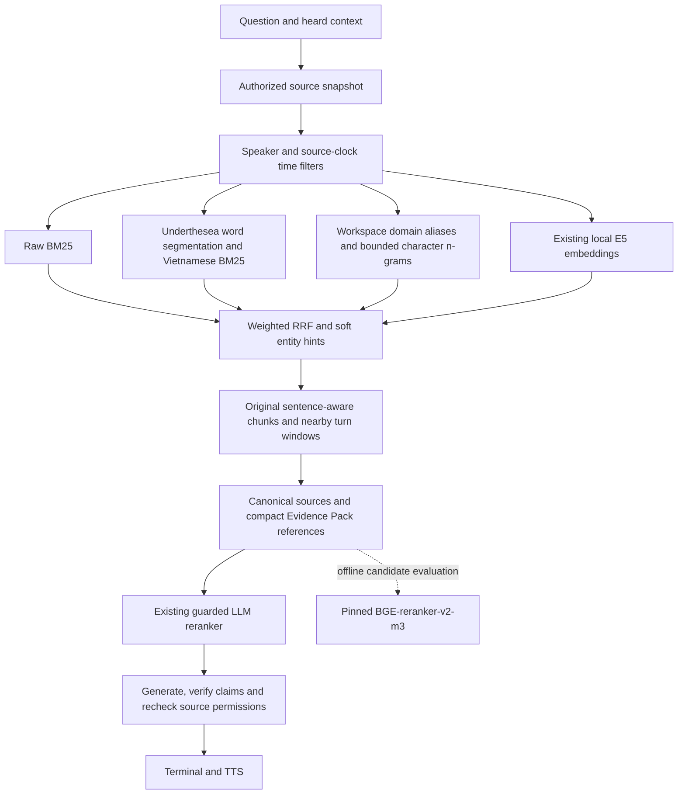

# Retrieval V2

TINA's voice/meeting retrieval keeps owner/session/policy authorization before ranking. LangGraph
still owns bounded planning and read concurrency, while TINA owns original-source verification,
revocation, draft review and heard history. ASR, KWS, VAD and TTS are unchanged.



## Search views

- Raw BM25 uses normalized Unicode word tokens and keeps codes/technical terms independently of
  Vietnamese segmentation. Underthesea 9.5.0/core 3.3.2 performs offline word segmentation in the
  control plane only; it is not a second agent runtime and does not segment E5 inputs.
- Raw/Vietnamese/alias/character channels share total lexical weight 0.50 (0.20/0.20/0.08/0.02),
  while E5 receives 0.50. Each channel nominates at most 16 candidates. These are initial engineering
  weights, not validated optimums or confidence probabilities. RRF deduplicates source indices.
- Character matching uses conservative trigram overlap on alphabetic terms of at least five
  characters, at most eight query terms, and a low weight. It never rewrites quotes or joins person
  identities. Standalone numbers and negation are not fuzzy-normalized.
- `retrieval-domain.json` may extend the built-in technical vocabulary in the selected workspace.
  The file is data, at most 32 KiB/128 groups/eight aliases per group, not executable config. Example:

```json
{"version":1,"aliases":{"aster":["át tơ"],"postgresql":["postgres","postgre sql"]}}
```

Aliases cannot change numbers or negation. Symlinks, invalid JSON/schema, unreadable files and oversized dictionaries
fall back atomically to built-in aliases with a content-free warning, including excessive JSON nesting;
no partially validated aliases are used.
They affect only ranking over already-authorized candidates and are never copied into
public web queries. Raw/canonical transcript, source fingerprints, IDs and quotes remain unchanged.

## Filters and context

Local search tools retain `{query}` arguments and also accept `{query, filters}`. Filters contain
`speaker_id`, `start_ms`, `end_ms` (nullable) and `entities` (up to three text hints). Speaker IDs must
be supplied source IDs, never inferred account identities. Source-clock millisecond intervals must
be explicit; the tool does not guess dates, relative-time conversions or speaker names. Entity hints
only boost ranking; they are not a hard filter or identity assertion. Speaker/time filters apply
before ranking and window expansion. Unknown IDs return no matches; they do not widen scope.

Typed calls normalize to the same `{name, query}` wire/Redis format, serializing an explicit filter
object within the unchanged 200-character total query budget. Legacy plain queries remain valid.
Malformed/extra/owner/meeting/path fields, non-integer/boolean timestamps and inverted ranges are
rejected. Large combinations may exceed the wire budget and must be shortened rather than truncated.
Filters apply per lookup; two explicitly planned lookups may intentionally compare different speakers
or intervals. When any lookup has a hard speaker/time filter, the final merge replaces the unfiltered
initial selection with the union of explicitly requested lookup results. Entity hints alone do not
remove initial context. Original room source permissions remain the global security boundary.

Long source chunks already prefer sentence/word boundaries and retain exact character offsets.
V2 expands anchors by up to two original neighboring chunks/turns, staying in the same document or
meeting and within the existing 30-second transcript neighborhood. With unpunctuated ASR, original
turn boundaries remain the fallback; no word/sentence timestamps are invented. The original
32-excerpt/24000-character and merged 48/36000 budgets remain. Recent and heard-context evidence
retention remains in place.
Search lookups and offline evaluation explicitly disable recent-context selection with `now_ms=0`.
With a real clock, recent context requires a known finite source timestamp; missing timestamps are
still searchable by content but are never labelled as recent.

Semantic initialization/inference failures keep lexical fallback and suppress retries for 30 seconds.
The next eligible request retries; a successful rank clears failure state. Artifact checks remain in
initialization, so recovery never skips checksum validation. An initialized encoder is reused after
a transient inference error; failures no longer disable semantic retrieval until process restart.

## Structured evidence

Canonical `sources` still carry each exact quote once with its ID/key/fingerprint and original
speaker/time/revision or document/paragraph/parent-character offsets. Each selected source adds
`retrieval` metadata for channel ranks, weighted RRF and context-only status. Internal
`evidence_pack` identifies `retrieval-evidence.v2`, candidate/selected coverage, `quote_container:
sources` and compact references to those same originals. It does not duplicate quotes or create a
new evidence store. Worker generation refreshes pack references after reranking; review still sees
all original retrieved evidence. Scores/entities/aliases are not factual proof or spoken content.

## Reranker candidate and evaluation

The production guarded LLM reranker remains the default. BGE is an optional offline candidate until
there is acceptable measured latency and reviewed relevance data; it does not replace numeric or
semantic answer verification. `control_plane/bge-reranker-assets.json` pins the model revision and
size/SHA256 for all six artifacts. Download is a separate explicit setup step, streaming to atomic
temporary files; inference uses local safetensors/tokenizer only with no network or remote code.

```sh
python3 core/agent/control_plane/voice_reranker.py --download

# Prepared eval Python needs the Agent base/control-plane packages plus torch/transformers.
PYTHONPATH=core/agent HF_HUB_OFFLINE=1 .venv/retrieval-eval/bin/python \
  core/agent/eval/voice/retrieval.py \
  --snapshot output/rag-meeting-eval/meetings.private.json \
  --dataset output/rag-meeting-eval/cases.private.json \
  --semantic --retrieval-version v2 \
  --bge-directory ~/.cache/tina/bge-reranker-v2-m3 \
  --output output/retrieval-v2/v2-bge.json
```

The BGE candidate scores at most 48 pairs, batch four/max 512 tokens; long pairs may truncate.
The raw score is relevance, not truth/confidence. Device selection is explicit (CPU default), with
no claim that native MPS results establish CUDA or Docker CPU performance. Weights remain outside
Git. Default `make all` prepares the pinned Underthesea/E5 runtime and retains the current LLM
reranker; it does not download/install a redundant 2.27 GB BGE model into every worker.

`retrieval.py --retrieval-version v1|v2 --k 10 --result-limit 12` applies the same final depth to
the baseline, BGE and LLM, including skipped/fallback reranks. Candidate selection retains the same
32-excerpt/24000-character budget. Full-evidence recall, all-evidence counts, MRR and Recall/NDCG@k
use only the capped final results; `k` must not exceed `result-limit` (maximum 48). Reports separately
record pre-rerank count/evidence recall so candidate coverage is not confused with final selection.
Compare reports only with matching budgets; historical uncapped full-recall counts are not comparable.
The report also includes p50/p95 latency. Relevance grades 1–3 are optional; existing exact-evidence labels give binary
grade 1. Unjudged sources count as zero for this provisional metric and cannot establish complete
relevance truth. Deduplication prevents repeated chunks of one labelled segment inflating NDCG.
Keep snapshot/case hashes and environment fixed. Reranker load time is separate from per-case
scoring. Startup/cold-cache cost and warm p95 require repeated larger runs.

Use `--llm-rerank` instead of `--bge-directory` to explicitly evaluate the existing guarded LLM
reranker through deployment environment credentials (may incur charges). It reports applied,
empty, skipped and fallback counts and provider/model labels. A valid empty selection keeps only
explicit recent/heard-history pins; it does not reintroduce per-meeting defaults or the unfiltered
retrieval. Worker repair cannot restore discarded source IDs; original evidence is retained for
contradiction review. This is not a signed-in Terminal user's
personal credential selection. No LLM run is performed by default and fallback is not counted as
an applied reranker. Real transcript snapshots/labels/reports remain private under ignored output/.
