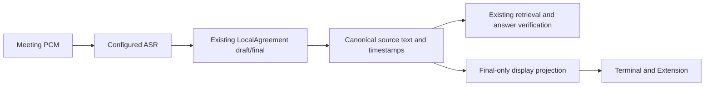

# Final transcript display formatting

Terminal and the Extension use the same pure TypeScript formatter at
`packages/transcript-rendering/src/format.ts`. No new service, model or inference request is needed.

The formatter is a view over final source segments (`completed !== false` for legacy finalized
rows); draft text is unchanged. No stored transcript, source quote, fingerprint, recording offset,
translation input or RAG result is rewritten. Speaker grouping happens after formatting. Bilingual
phrase groups carry their exact source members so display conversion cannot cross ASR boundaries.
The UI shows formatted final text without an original-ASR disclosure. Raw text remains in
canonical source data; evidence panels continue to quote the source text. Display changes are
not evidence corrections.

## Supported explicit forms

| Input | Display |
|---|---|
| mười chín phần trăm | 19% |
| âm hai phẩy năm phần trăm | -2,5% |
| một trăm triệu đồng | 100 triệu đồng |
| ngày mười lăm tháng mười một năm hai nghìn không trăm hai mươi sáu | ngày 15/11/2026 |
| ngày mười lăm tháng mười một | ngày 15/11 |
| lúc chín giờ rưỡi sáng | lúc 09:30 |
| lúc ba giờ mười lăm chiều | lúc 15:15 |
| số điện thoại là không chín một hai ba bốn năm sáu bảy tám | số điện thoại là 0912345678 |
| Python phiên bản ba chấm mười một | Python phiên bản 3.11 |
| mã A gạch ngang một hai ba | mã A-123 |
| mã chữ thường a gạch dưới một hai | mã a_12 |

Phones require an explicit phone introduction and a clear digit sequence. Domestic forms retain
their initial zero and have 9–11 digits; explicitly international cộng/+ forms have 8–15 digits
and a nonzero first country-code digit. These are conservative formatting bounds, not country-
specific telephone validation. The formatter never pads digits or infers a country/operator.

Technical versions require a known name (PostgreSQL, Python, Node.js, CUDA, GPT or API) followed
by `phiên bản`. Codes require explicit `mã` context, a letter, digits and a spoken separator.
Literal letters retain their written case; explicit chữ hoa/thường is honored. Unsupported
letter names, O/0 and I/1 ambiguity, unknown products and unseparated codes stay unchanged.

Calendar dates are validated, including leap years. Relative dates such as mai or thứ Sáu tới
are never resolved. Impossible dates, relative years, approximate/subtractive hours, ambiguous
numeric grouping/year phrases and incomplete phone/code spans stay raw rather than being
partially converted. URLs, emails, inline/fenced code and contested transcript markup are protected.
Unchanged legacy code/digit strings stay verbatim. No model can recover omitted/misheard characters
through formatting; verify important codes and numbers against audio.

## Projection contract and shipping

`formatTranscript(original, completed, sourceParts?)` returns original text, display text, a
`vi-display.v1` marker and nonoverlapping changes with original character offsets, exact source,
replacement and kind. Texts over 50000 characters are left raw. Original input objects remain
immutable; repeated calls are deterministic and formatted output is idempotent.

Terminal uses a memoized per-segment projection and keeps playback click IDs/timestamps. Search
matches raw and formatted text. Extension uses the same formatter with its stable DOM rows;
source formatting metadata stays client-side and never goes to ASR/LLM or persistence.

The Terminal Dockerfile copies only this dependency-free formatter source from the shared package,
so both production and dev images resolve the same import without adding npm dependencies. Extension
esbuild bundles that same source into `clients/extension/dist`. Rebuild/recreate Terminal to activate
its bundle, then refresh existing tabs. Reload the unpacked extension from Chrome's extensions page
to activate its rebuilt bundle. Neither operation changes ASR model/runtime selection.

Checks: package formatter tests and typecheck/build; Terminal renderer/translation/navigation tests
and typecheck/production build; Extension existing lifecycle/translation tests, typecheck, isolation
and build. Synthetic real-component browser smoke and measurements live under ignored
`output/transcript-display-20261115/`. They do not establish recognition accuracy on actual audio.
